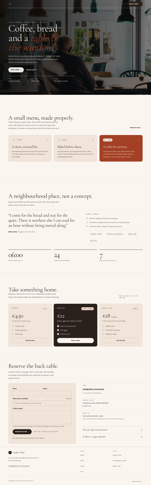
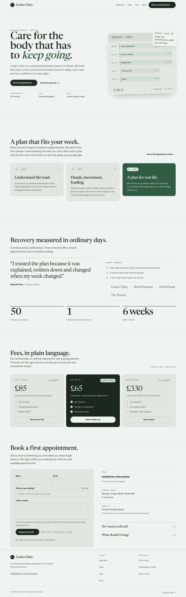

<div align="center">

# Frontend Design Skills

### Studio-grade frontend builds, verified in a real browser.

**One art direction. One visual system. Real assets. Real copy. Evidence from Chrome.**
No page ships until the gate says `GATE: PASS`.

[](https://skills.sh)
[](#the-finish-gate)
[](package.json)
[](LICENSE)
[](#)
[](#compatibility)
[](https://github.com/rafidone/frontend-design-skills)

[Quick start](#quick-start) · [Installation](#installation) · [Architecture](#architecture) · [Niche matrix](#niche-matrix) · [Finish gate](#the-finish-gate) · [Examples](#six-reference-builds)

</div>

---

## Why this exists

Most AI-generated frontends fail in the same four ways: a generic template layout, an
uncommitted visual direction, fake or missing assets, and no proof that the result
actually works in a browser.

**Frontend Design Skills is the operating system for one build.** It classifies the
business, locks an art direction, generates a real visual system, writes honest copy,
captures real browser evidence at seven viewports, fixes what Chrome proves is wrong,
and returns a gate report you can defend in a client review.

It is not a component library, a prompt pack, or a screenshot generator. It is a
production workflow with hard stops.

```text
GATE: PASS
Built: a studio operations site for a six-person design practice
Direction: service / shell-forest / newsreader-dm / hero split / T0
Viewports: 1440, 1280, 1024, 820, 768, 390, 320
Waivers: none
Open: none
Assets: 1 local WebP, 66 local SVG icons, 4 diagrams, credits.html
Assumptions: the brief did not name a city, so Lisbon was used in the demo copy
```

> **The contract:** a page is not finished because the code compiles. It is finished
> when the browser gate passes, the screenshots have been read, and every finding is
> fixed, waived with evidence, or reported.

---

## Quick start

```bash
# 1. Install the skill from GitHub (Skills CLI)
npx skills add rafidone/frontend-design-skills --skill frontend-design-skills -a opencode -y

# 2. Ask your agent for the build
#    "Build a booking page for a six-room boutique hotel in Lisbon."
```

The skill activates for landing pages, marketing sites, SaaS and product pages,
dashboards, portfolios, storefronts, game and hardware sites, hospitality sites,
professional-service sites, and any existing UI that looks generic or unfinished.

```bash
# List everything published by this repository
npx skills add rafidone/frontend-design-skills --list

# Install for every detected agent
npx skills add https://github.com/rafidone/frontend-design-skills \
  --skill frontend-design-skills -y

# Install globally for the current user
npx skills add rafidone/frontend-design-skills \
  --skill frontend-design-skills -a opencode -g -y
```

---

## Installation

### Skills CLI

| Scope | Command | Use when |
| --- | --- | --- |
| Project | `npx skills add rafidone/frontend-design-skills --skill frontend-design-skills` | The skill belongs in the repository and ships with the team. |
| Global | `npx skills add rafidone/frontend-design-skills --skill frontend-design-skills -g` | The skill should follow you across projects. |
| Specific agent | `npx skills add rafidone/frontend-design-skills --skill frontend-design-skills -a opencode -a claude-code` | You use more than one coding agent. |
| All agents | `npx skills add rafidone/frontend-design-skills --skill frontend-design-skills --agent '*'` | You want it everywhere. |
| Direct path | `npx skills add https://github.com/rafidone/frontend-design-skills/tree/master/skills/frontend-design-skills` | You want to pin the exact skill directory. |

### Claude Code plugin marketplace

This repository ships both `.claude-plugin/marketplace.json` and
`.claude-plugin/plugin.json`, so the same SKILL.md can be installed through the
Claude Code plugin flow:

```text
/plugin marketplace add rafidone/frontend-design-skills
/plugin install frontend-design-skills@frontend-design-skills
```

### Local checkout

```bash
git clone https://github.com/rafidone/frontend-design-skills.git
cd frontend-design-skills

# Copy into the current project's .opencode/skills
./install.sh --project

# Install globally into ~/.config/opencode/skills
./install.sh --global

# Symlink while developing the skill itself
./install.sh --link --project /path/to/project

# Remote install through the Skills CLI from this helper
./install.sh --remote --agent opencode

# Inspect what the remote repository publishes
./install.sh --list
```

The local installer copies `skills/frontend-design-skills/` to
`.opencode/skills/frontend-design-skills/` (or the global skills directory) and then
runs the environment doctor. In OpenCode, invoke it as `@frontend-design-skills`.

### Requirements

| Requirement | Why |
| --- | --- |
| **Node 22+** | The scaffold, asset, server, audit, and gate tooling. |
| **Chrome or Chromium** | Real-browser inspection. Playwright is optional; the zero-dependency CDP engine is the fallback. |
| **`python3`** | Optional, for the generated static preview command. The skill's own server is Node. |
| **`ffmpeg`** | Optional, for image statistics and WebP encoding. |

```bash
npm run doctor
```

---

## Architecture

```text
 brief
   │
   ▼
 classify ──► assign.mjs ──► palettes · type pairs · heroes · composition
   │
   ▼
 scaffold.mjs ──► tokens · components · local assets · 7 framework adapters
   │
   ▼
 build ──► real copy · local photography · SVG icons · diagrams · mock data
   │
   ▼
 serve.mjs ──► http://127.0.0.1:<port>
   │
   ▼
 inspect.mjs ──► Chrome or Playwright ──► 8 audits × 7 viewports
   │
   ▼
 verify.mjs ──► rounds · waivers · screenshots · report.json/html/md
   │
   ▼
 PASS · PASS WITH WAIVERS · FAIL n · OPEN n · SETUP · ERROR · DONE
```

| Layer | Responsibility |
| --- | --- |
| `SKILL.md` | The nine-step run loop, hard stops, output contract, and commands. |
| `rules/00–90` | Ten rule documents from house rules to the verification checklist. |
| `references/` | Nine decision references: niche matrix, copy, assets, gates, frameworks, troubleshooting. |
| `assets/` | 24 palettes, 24 type pairings, 10 heroes, 7 sections, 14 UI fragments, 4 diagrams, 66 icons, 7 photographs, 6 mock-data sets. |
| `scripts/` | Assignment, scaffolding, asset checks, serving, browser inspection, eight audit modules, capture, verification, and reporting. |
| `examples/` | Six complete, gate-verified reference builds. |
| `tests/` | Unit tests for the pure machinery plus a real-browser end-to-end run. |

### Deterministic by design

The direction is assigned from the niche and a seed, not sampled from a model's mood:

```bash
node skills/frontend-design-skills/scripts/assign.mjs \
  --niche software --seed studio-01 --json
```

The result locks a palette, type pair, hero archetype, rendered hero layout, motion
tier, density, and composition. The lock is written to
`.frontend-design-skills/art-direction.json` and is treated as immutable for the run.
A second palette, a second type system, or a second button is a defect, not a choice.

### Seven framework adapters

The static HTML build is the reference implementation. The same tokens, container,
and component vocabulary render for:

`html` · `react` · `next` · `vue` · `svelte` · `astro` · `tailwind`

The checker does not care which framework rendered the DOM. It cares what Chrome
paints.

---

## Niche matrix

Each row is an operational system: first viewport, page shape, palette, type, proof,
motion ceiling, and the mistakes that break the row. The full matrix lives in
[`references/niche-matrix.md`](skills/frontend-design-skills/references/niche-matrix.md).

| Niche | Visitor is deciding… | First viewport must show | Proof signal | Motion |
| --- | --- | --- | --- | --- |
| **SaaS / devtool** | Whether the tool does the job | Real product UI in a real state, category, outcome, primary action | Live-looking UI, benchmark with method, status page | T1 |
| **AI** | Whether the model can perform the task | A real input/output pair or working demo, constraints named | Reproducible examples, evaluation, latency, human review | T1 (T2 with a real demo) |
| **Gaming** | Whether to play or wishlist | One dominant key-art or in-engine frame, release window, platforms | In-engine footage, platform listing, studio credits | T2 |
| **Hardware** | Whether the object is right | Product photograph at a believable angle, defining property, spec link | Measured specs, materials, test conditions, certification | T1 (T2 for real 3D) |
| **Commerce** | Whether to buy this item | Product isolated with price, variants, delivery estimate, returns | Real inventory, delivery window, verified reviews | T1 |
| **Hospitality** | Whether to stay or book | Real place, room, or table photograph; booking path; location | Current photography, address, hours, menu, policies | T1 |
| **Service** | Whether to hire this provider | Promise tied to a service and place; real person or work; hours | Licence, insurance, years, named result, response time | T0 / T1 |
| **Editorial** | Whether to read or subscribe | Masthead, lead story, byline, date, real image or chart | Sources, issue number, corrections policy, real photography | T0 / T1 |

### The four direction locks

| Lock | What it prevents |
| --- | --- |
| **Palette** | Two competing accents, default tech blue, violet/lavender drift. |
| **Typography** | Display type that fails to load, body copy below 16px, measures over 62 characters. |
| **Composition** | Generic three-card grids, heroes that do not own the first screen, sections between 1.16H and 1.84H. |
| **Assets** | Empty boxes, grey placeholders, stock gradients, fake dashboards, icon CDNs. |

---

## The finish gate

`verify.mjs` opens the page in a real browser, collects facts once per viewport, and
runs **eight audits** across **42 rule IDs**:

| Audit | Rule family | What it proves |
| --- | --- | --- |
| **Layout** | `LAY-01…06` | Hero ownership, section budget, equal edges, overflow, reading order. |
| **Typography** | `TYP-01…05` | Body size, measure, hierarchy, font loading, orphaned display type. |
| **Color** | `COL-01…03` | Contrast, single accent, system consistency. |
| **Visual** | `VIS-01…03` | Real visuals, no empty boxes, no captions-as-design. |
| **Motion** | `MOT-01…03` | Reduced-motion safety, scroll behaviour, WebGL budget. |
| **Accessibility** | `A11Y-01…06` | Focus visibility, landmarks, names, contrast, keyboard paths. |
| **Performance** | `PERF-01…03` | LCP, layout shift, request and stylesheet budget. |
| **Copy & assets** | `COP-01…04`, `AST-01…03`, `SYS-01…04`, `NICHE-01…02` | Honest claims, working assets, one system, niche fit. |

```bash
# Full gate against a built page
node skills/frontend-design-skills/scripts/verify.mjs ./site \
  --full --kind software --category "release planning" --primary "book a demo"

# Quick desktop pass while iterating
node skills/frontend-design-skills/scripts/verify.mjs ./site --quick

# Re-render a previous run
node skills/frontend-design-skills/scripts/report.mjs \
  --run ./site/.frontend-design-skills/runs/<timestamp>
```

### Gate states

| State | Meaning | Deliver? |
| --- | --- | --- |
| `GATE: PASS` | No blocking findings, no open items. | **Yes** |
| `GATE: PASS` with waivers | All findings pass or are documented false positives (≤5). | **Yes** |
| `GATE: FAIL n` | `n` blocking findings remain. | No |
| `GATE: OPEN n` | Findings remain at the round cap. | No |
| `GATE: SETUP` | The page could not be served or inspected. | No |
| `GATE: ERROR` | An audit crashed. | No |
| `GATE: DONE` | The run was explicitly closed with `--done`. | Review |

### Evidence, not opinion

- Every finding records a rule ID, selector, viewport, observed value, and fix.
- The run writes `report.json`, `report.html`, `report.md`, and screenshots under
  `.frontend-design-skills/runs/<timestamp>/`.
- `PASS` without evidence is downgraded to `OPEN`.
- Structural failures cannot be waived: `LAY-01`, `LAY-04`, `A11Y-03`, `COL-01`,
  `SYS-04`.
- Waivers need a target, a reason of at least twelve characters, and a documented
  false positive. The default cap is three rounds and five waivers.
- The checker scripts are never edited to make a page pass.

---

## Six reference builds

Each example is a standalone static build with its own direction lock, local assets,
and gate report. Every screenshot below was captured from the actual build at 1440px.

| Build | Niche | Direction | Preview |
| --- | --- | --- | --- |
| [`saas-product`](examples/saas-product/) | Software | `navy-signal` / `schibsted-source` / split |  |
| [`devtool-diff`](examples/devtool-diff/) | Developer tool | `coal-signal` / `bricolage-plex` / split |  |
| [`gaming-ironwood`](examples/gaming-ironwood/) | Gaming | `deep-forest` / `anton-archivo` / film · media |  |
| [`hardware-macro`](examples/hardware-macro/) | Hardware | `ice-copper` / `archivo-plex` / photo · media |  |
| [`cafe-atelier`](examples/cafe-atelier/) | Hospitality | `terracotta-clay` / `cormorant-karla` / photo · media |  |
| [`service-clinic`](examples/service-clinic/) | Professional service | `light-sage` / `newsreader-dm` / split |  |

| Build | What it demonstrates |
| --- | --- |
| `saas-product` | Product-led split hero, proof metrics, plan comparison, two-column contact block. |
| `devtool-diff` | Dense review UI, diff fragment, install-first CTA, local-first copy. |
| `gaming-ironwood` | Cinematic key art, low copy, edition cards, field-notes signup. |
| `hardware-macro` | Macro product photograph, specification rail, reserve flow. |
| `cafe-atelier` | Warm editorial type, menu, opening hours, table booking. |
| `service-clinic` | Calm care pathway, practitioner proof, appointment form. |

Run any example locally:

```bash
python3 -m http.server 4173 --directory examples/cafe-atelier
# open http://127.0.0.1:4173

# Or use the skill's own pipeline
node skills/frontend-design-skills/scripts/inspect.mjs examples/cafe-atelier --full
node skills/frontend-design-skills/scripts/verify.mjs examples/cafe-atelier --full --kind hospitality
```

The expected warning is the shared six-stylesheet first paint (`PERF-03`). Any other
finding is called out in the run report and should be reviewed before shipping.

---

## What is in the box

| Asset | Count | Purpose |
| --- | ---: | --- |
| Validated palettes | 24 | Contrast-checked color systems with one accent. |
| Type pairings | 24 | Display and text pairs with real font loading. |
| Hero archetypes | 10 | Split, full-bleed media, editorial, statement, product, and more. |
| Section patterns | 7 | Proof, features, pricing, split feature, FAQ, CTA, footer. |
| UI fragments | 14 | Analytics, billing, calendar, chat, command palette, diff, invoice, kanban, map, media, notifications, search, settings, table. |
| Diagram patterns | 4 | Architecture, tool hub, pipeline, sequence. |
| Icons | 66 | 50 UI icons and 16 brand icons, all local SVG with a manifest. |
| Photographs | 7 | Local WebP with dimensions, SHA-256, author, licence, and source. |
| Mock-data sets | 6 | Cities, companies, metrics, people, products, schedule. |
| Rule documents | 10 | The design and engineering standard, in load order. |
| References | 9 | Compact decision tables for the whole run. |

### Commands

All commands are relative to the skill directory unless a target is given.

| Command | Purpose |
| --- | --- |
| `doctor.mjs` | Check Node, Chrome, Playwright, ffmpeg, and skill assets. |
| `lint-name.mjs` | Enforce the clean-room name rule across the repository. |
| `assign.mjs` | Deterministically assign palette, type pair, hero, and composition. |
| `scaffold.mjs` | Generate HTML, React, Next, Vue, Svelte, Astro, or Tailwind. |
| `assets.mjs` | Verify manifests, list icons, fetch photos, and write credits. |
| `serve.mjs` | Start a local static server for inspection. |
| `inspect.mjs` | Run the eight browser audits at selected viewports. |
| `capture.mjs` | Capture full-page screenshots at every viewport. |
| `verify.mjs` | Run the stateful finish gate with rounds and waivers. |
| `report.mjs` | Re-render a run as Markdown or HTML. |

```bash
node skills/frontend-design-skills/scripts/assets.mjs verify
node skills/frontend-design-skills/scripts/assets.mjs photos list --query cafe
node skills/frontend-design-skills/scripts/inspect.mjs examples/cafe-atelier --quick
node skills/frontend-design-skills/scripts/capture.mjs examples/cafe-atelier --out /tmp/shots
```

---

## Compatibility

| Surface | Support |
| --- | --- |
| **Agents** | OpenCode, Claude Code, Codex, Cursor, and 75+ agents supported by the Skills CLI. |
| **Frameworks** | Plain HTML/CSS/JS, React, Next.js, Vue, Svelte, Astro, Tailwind CSS v4. |
| **Browsers** | Local Chrome or Chromium through `playwright-core` or the zero-dependency CDP engine. |
| **Operating systems** | Linux, macOS, and Windows. |

---

## Quality and clean-room policy

This repository is a clean-room implementation. It does not copy code, prose, asset
names, or naming conventions from any external design-skill project. A prohibited
reference term is never written anywhere in the repository; `lint-name.mjs` assembles
the term at runtime and scans every text file, filename, directory name, and config.
The linter is part of CI and must stay green.

```bash
npm run lint:name   # clean-room name rule
npm test            # 40 pure unit tests
npm run test:e2e    # real-browser fixture run
npm run doctor      # environment and installation health
```

The end-to-end test builds temporary fixtures, serves them, runs the same audits used
by the skill, and asserts that the good fixture passes while the bad fixture produces
the expected rule IDs.

---

## Repository layout

```text
frontend-design-skills/
├── skills/
│   └── frontend-design-skills/        # installable skill (npx skills add)
│       ├── SKILL.md                   # operating loop, hard stops, output contract
│       ├── rules/                     # 00–90 operating rules
│       ├── references/                # niche matrix, copy, assets, gate, frameworks
│       ├── assets/
│       │   ├── palettes/              # 24 validated palettes
│       │   ├── typography/            # 24 validated type pairings
│       │   ├── starter/               # reference HTML/CSS/JS system
│       │   ├── heroes/                # 10 hero archetypes
│       │   ├── sections/              # 7 reusable section patterns
│       │   ├── fragments/             # 14 realistic UI fragments
│       │   ├── diagrams/              # 4 diagram patterns
│       │   ├── icons/                 # UI and brand SVGs plus manifest
│       │   ├── photos/                # local WebP, manifest, credits pipeline
│       │   └── mock-data/             # realistic JSON fixtures
│       └── scripts/                   # assign, scaffold, browser, audits, gate
├── examples/                          # 6 complete, gate-verified builds
├── docs/
│   ├── architecture.md
│   ├── authoring-rules.md
│   ├── release.md
│   └── previews/                      # screenshots captured from the builds
├── tests/
│   ├── unit/
│   ├── e2e/
│   └── fixtures/
├── .claude-plugin/                    # marketplace + plugin manifests
├── install.sh                         # local + remote installer
├── package.json
├── CHANGELOG.md
├── LICENSE
└── README.md
```

---

## Documentation

- [Architecture](docs/architecture.md) — how the skill, audits, and gate fit together.
- [Authoring rules](docs/authoring-rules.md) — how to add rules, assets, and examples.
- [Release guide](docs/release.md) — versioning, verification, and release checks.
- [Examples](examples/README.md) — the six builds and their exact directions.
- [Changelog](CHANGELOG.md) — released capability.

---

## Licence

MIT. See [LICENSE](LICENSE).

<div align="center">

**If a page is not verified, it is not finished.**

`GATE: PASS`

</div>
